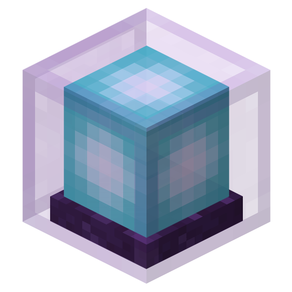

# Nova Craft Launcher (NCL)

**Next-Generation Minecraft Launcher & Runtime Manager**

[🇨🇳 简体中文](../README.md) | **🇬🇧 English** | [🇭🇰 繁體中文](README_TC.md)

  

  

 ## ⚠️ Current Status

> The project is currently in the **Pre-development phase**.
>
> - ❌ No compilable/runnable code available yet
> - ❌ No Release versions or CI pipelines yet
> - ✅ Finalizing the underlying architecture and adapter specifications
>
> **Please do not expect to download and use it right now.** Welcome to Watch / Star for updates.

## 📖 Project Overview

NCL is not just another Minecraft launcher with a patched shell, but a **modular, high-performance runtime management and content scheduling platform built from scratch**. We are committed to solving the common issues in the current ecosystem, such as performance bottlenecks, chaotic file management, and lack of security.

## 🏗️ Technical Architecture

Rejecting the monolithic giant, we adopt a **.NET + Go** hybrid architecture to achieve a win-win situation of performance and security:

- **Presentation Layer (C# / Avalonia)**: Responsible for cross-platform UI rendering, using MVVM and compile-time binding to ensure a smooth interface under complex data.
- **Core Engine (Go)**: Acts as an independent daemon process, dedicated to handling high-concurrency downloads, low-level file I/O, hash verification, and local indexing.
- **IPC Communication**: The UI and engine communicate through local Sockets, achieving **crash isolation** (engine exceptions will not cause the software to crash), and supporting future plugins in any language to connect via JSON-RPC.

## ✨ Architecture Goals

*(Note: The following are underlying design goals; specific implementations will be continuously validated during development)*

- **Performance Scheduling**: Plans to adopt a DAG startup pipeline and hierarchical verification (timestamp -> hash) to attempt efficient concurrency for large directories and multiple tasks.
- **Infinite Ecosystem**: Design declarative adapters (configuration-driven), reserve unified abstraction for Java/Bedrock Edition, Client/Server, and specifically adapt to special directories like shaders and blueprints.
- **Security Baseline**: Enforce hash verification, prevent path traversal (Zip Slip), adopt transactional installation and failure rollback to ensure file security.

## 🗺️ Roadmap

- **#0** — Repository initialization, interface definition, and specification establishment *(Current Goal)*
- **#1** — Core framework and GUI skeleton (Avalonia shell, Go engine, IPC communication)
- **#2** — Java Client MVP (Startup pipeline, download/verification kernel, Java management)
- **#3** — Java Server lifecycle management (Console, RCON, process daemon)
- **#4** — Content management system and all-platform expansion (Modpacks, Bedrock Edition, plugin ecosystem)

### 💬 Discussion & Feedback

Welcome to participate in architecture discussions in [Discussions](https://github.com/ZhangXaohan-awa/Nova-Craft-Launcher/discussions), or submit high-quality Issues.

## 📄 License

This project is licensed under the [GPLv3](../LICENSE) license (including supplementary terms for ecosystem marking). See [License Explained](LICENSE-EXPLAINED.md) for details.

---

  <i>Nova Craft Launcher - Guided by Starlight, Explore Infinite Possibilities</i>

  <i>Nova Craft Launcher (NCL) is a completely independent and open-source third-party software project. This project is not affiliated with, authorized, sponsored, or endorsed by Mojang Studios, Microsoft, or any of their subsidiaries or affiliates. This software does not contain any copyrighted official game files. All related trademarks and copyrights used in the game belong to their respective owners.</i>

